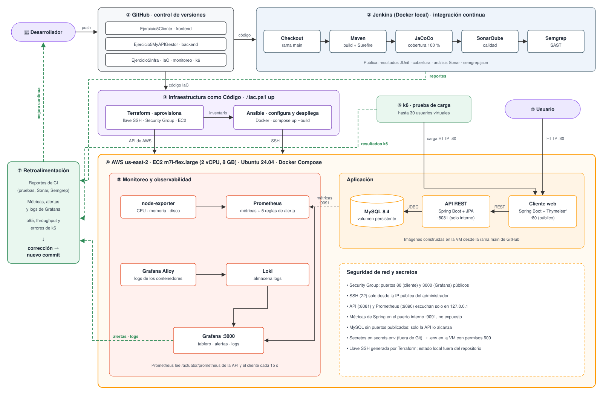

# Ejercicio5Infra

Infraestructura como Código del gestor de proyectos Ejercicio5. Un solo comando crea una VM en AWS y despliega en ella el cliente web, la API y MySQL:

- [Ejercicio5Cliente](https://github.com/Marco33100/Ejercicio5Cliente) (frontend, Spring Boot + Thymeleaf)
- [Ejercicio5MyAPIGestor](https://github.com/Marco33100/Ejercicio5MyAPIGestor) (backend, API REST)

## Arquitectura



Flujo completo y justificación de cada decisión: [docs/arquitectura.md](docs/arquitectura.md).

## Herramientas y justificación

| Herramienta | Alcance | Por qué |
|---|---|---|
| **Terraform** | Aprovisionamiento: llave SSH, grupo de seguridad (firewall) y VM EC2 en AWS | Declarativo, con estado y plan previo (`plan`); recrea la misma infraestructura desde cero y la destruye con un comando. |
| **Ansible** | Configuración: instala Docker desde su repositorio oficial, copia la aplicación, escribe los secretos y despliega | Terraform no configura el sistema operativo. Ansible lo hace por SSH, sin agentes en la VM, con tareas idempotentes y verificaciones al final. |
| **Docker Compose** | Ejecución: MySQL 8.4, API y cliente en una red interna | Usa los mismos `Dockerfile` de cada repositorio; las imágenes se construyen en la VM directamente desde GitHub. |
| **AWS EC2 (plan gratuito)** | Servicio cloud | El plan gratuito de cuentas creadas desde el 15/07/2025 no genera cargos: al agotar los créditos los recursos se detienen. `m7i-flex.large` (2 vCPU, 8 GB) es elegible. |

Render no se usa para esta parte porque su API (y por lo tanto su provider de Terraform) no permite crear servicios del plan gratuito ([issue #44](https://github.com/render-oss/terraform-provider-render/issues/44)).

## Arquitectura desplegada

```
Internet ──:80───▶ cliente (8080) ──red interna──▶ api (8081) ──▶ mysql (3306, volumen persistente)
Internet ──:3000─▶ grafana ──▶ prometheus ──(:9091 /actuator/prometheus)──▶ api, cliente
                           │             └──▶ node-exporter (CPU, memoria, disco de la VM)
                           └─▶ loki ◀── alloy (logs de todos los contenedores)
Tu IP ────:22────▶ SSH (Ansible)
```

Solo los puertos 80 (cliente) y 3000 (Grafana, con usuario y contraseña) son públicos. Las métricas de Spring Boot se publican en un puerto interno (9091) que solo alcanza Prometheus. SSH se limita a la IP de quien ejecuta Terraform. La API solo escucha en `127.0.0.1` de la VM y MySQL no publica puertos.

## Monitoreo y observabilidad

| Componente | Función |
|---|---|
| Spring Boot Actuator + Micrometer | La API y el cliente exponen métricas (peticiones, códigos HTTP, latencia con histograma, JVM). |
| Prometheus | Recolecta métricas cada 15 s y evalúa las reglas de [alertas.yml](app/monitoring/prometheus/alertas.yml). |
| node-exporter | CPU, memoria, disco y red de la VM. |
| Loki + Grafana Alloy | Alloy lee los logs de los contenedores del proyecto y los envía a Loki. |
| Grafana | Tablero `Ejercicio5 · Monitoreo` provisionado como código: disponibilidad, CPU, memoria, peticiones/s, errores 4xx/5xx, latencia p95, heap JVM y logs. |

Alertas: `ServicioCaido` (un objetivo sin responder 1 min), `TasaErrores5xxAlta` (> 5 % durante 2 min), `LatenciaP95Alta` (> 1 s durante 5 min), `CPUAlta` (> 85 %) y `MemoriaAlta` (> 90 %). Se ven en Grafana → **Alerting → Alert rules**. No hay notificaciones por correo: las alertas se observan en el tablero.

Grafana: `http://<ip>:3000`, usuario `admin`, contraseña `GRAFANA_PASSWORD`.

## Estructura

```
terraform/   aprovisionamiento en AWS (genera ansible/inventory.ini y .ssh/ejercicio5.pem)
ansible/     configuración de la VM y despliegue
app/         compose.yml, inicialización de MySQL y configuración de monitoreo (monitoring/)
tools/       imagen Docker con Terraform 1.9.8 y ansible-core 2.17.7
iac.ps1      ejecuta todo desde Windows dentro de esa imagen
```

## Requisitos

- Docker Desktop. Terraform y Ansible no se instalan en Windows: corren en un contenedor.
- Cuenta de AWS en el **plan gratuito** (Free plan, no el plan de pago).
- Un usuario IAM con llaves de acceso (no uses las llaves de la cuenta raíz):
  1. Consola de AWS → **IAM → Users → Create user** (por ejemplo, `terraform`).
  2. **Attach policies directly** → `AmazonEC2FullAccess`.
  3. En el usuario creado: **Security credentials → Create access key → Command Line Interface (CLI)**.

## Uso

```powershell
Copy-Item secrets.env.example secrets.env   # y completa los valores
.\iac.ps1 init      # descarga los providers de Terraform
.\iac.ps1 plan      # muestra qué se va a crear
.\iac.ps1 up        # crea la VM y despliega (10-15 min la primera vez: compila ambos proyectos)
```

Al terminar, Terraform muestra `url_cliente` y Ansible confirma que la API responde con la base de datos y que el cliente responde en el puerto 80. Inicia sesión con `ADMIN_EMAIL` / `ADMIN_PASSWORD`.

Otros comandos:

| Comando | Qué hace |
|---|---|
| `.\iac.ps1 apply` | Solo Terraform |
| `.\iac.ps1 deploy` | Solo Ansible (redespliega la última versión de `main` de ambos repositorios) |
| `.\iac.ps1 ssh` | Entra a la VM |
| `.\iac.ps1 destroy` | Elimina todos los recursos de AWS |

## Seguridad

- Los secretos solo viven en `secrets.env` (ignorado por Git) y en `/opt/ejercicio5/.env` de la VM con permisos `600`.
- Terraform genera la llave SSH. La privada queda en `.ssh/` y en `terraform.tfstate`, ambos ignorados por Git.
- El usuario inicial solo se crea la primera vez que arranca MySQL (volumen vacío).

## Limitaciones

- El estado de Terraform es local. Para trabajar en equipo convendría un backend remoto (S3).
- La IP pública cambia si la VM se detiene y se vuelve a iniciar; `apply` regenera el inventario.
- La API guarda las contraseñas en texto plano: es una limitación del código existente, no de esta infraestructura.
