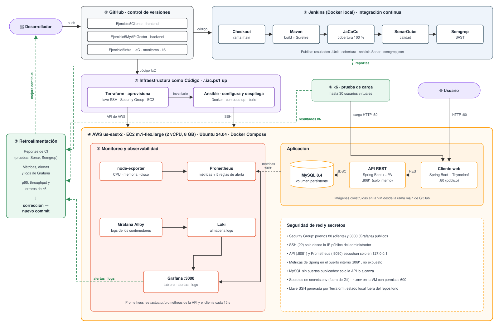

# Arquitectura DevOps

[Versión PNG para el informe](arquitectura.png)

## Flujo

1. **Control de versiones.** El código vive en tres repositorios de GitHub: cliente, API e infraestructura. Los cambios llegan a `main` mediante ramas y Pull Requests.
2. **Integración continua.** Jenkins, en un contenedor local, descarga `main` de cada aplicación, compila con Maven, ejecuta las pruebas (Surefire), mide cobertura (JaCoCo), analiza calidad (SonarQube) y seguridad (Semgrep), y publica los reportes.
3. **Infraestructura como Código.** `.\iac.ps1 up` ejecuta Terraform, que crea en AWS la llave SSH, el Security Group y la VM y genera el inventario. Después ejecuta Ansible, que entra por SSH, instala Docker y despliega la aplicación con Docker Compose.
4. **Despliegue cloud.** En la VM EC2 corren el cliente web (único servicio de la app expuesto, puerto 80), la API REST (solo red interna) y MySQL (volumen persistente). Las imágenes se construyen en la VM desde `main`.
5. **Monitoreo y observabilidad.** Prometheus recolecta las métricas de Spring Boot (puerto interno 9091) y de la VM (node-exporter) y evalúa 5 reglas de alerta. Alloy envía los logs de los contenedores a Loki. Grafana (puerto 3000) muestra el tablero, las alertas y los logs.
6. **Rendimiento.** k6 genera carga controlada contra el cliente con el flujo real de un usuario.
7. **Retroalimentación.** Los reportes de CI, las alertas, las métricas y los resultados de k6 vuelven al desarrollador, que corrige y hace un nuevo commit, y el ciclo se repite.

## Justificación de las decisiones

| Decisión | Alternativas consideradas | Motivo |
|---|---|---|
| **GitHub** | GitLab, Bitbucket | Los repositorios ya existían ahí. Los PR dejan trazabilidad de cada cambio. |
| **Jenkins** en Docker local | GitHub Actions | Ya estaba configurado desde las unidades I y II, con SonarQube y MySQL de CI en la misma red de Docker. |
| **SonarQube + Semgrep** | Solo uno de los dos | Son complementarios: Sonar mide calidad y deuda técnica, Semgrep busca patrones de seguridad (SAST). |
| **AWS EC2** | Render, Oracle Cloud, Azure | Render no permite crear servicios gratuitos con Terraform (su API lo bloquea). El plan gratuito de AWS da créditos sin riesgo de cargos, y `m7i-flex.large` alcanza para la app y el monitoreo. |
| **Terraform + Ansible** | Solo Terraform con *user-data*, solo Ansible | Terraform aprovisiona (crea recursos de AWS con estado y plan previo) y Ansible configura (instala y despliega por SSH). Juntos cubren las dos fases que pide la rúbrica, cada una con la herramienta adecuada. |
| **Docker Compose** en una VM | Kubernetes (EKS), ECS | Para 3 servicios de aplicación y 5 de monitoreo, Compose basta. Kubernetes añadiría costo y complejidad sin beneficio a esta escala. |
| **MySQL en contenedor** | TiDB Cloud (antes), RDS | Toda la infraestructura queda dentro del código y se recrea con un comando. RDS consumiría créditos aparte. |
| **Prometheus + Grafana + Loki** | Datadog, CloudWatch | Son libres, corren en la misma VM sin cuentas externas, y el tablero y las alertas se versionan como archivos. |
| **k6** | JMeter | El escenario es un script versionable (JavaScript), corre en Docker sin interfaz gráfica y exporta un reporte HTML. |

## Seguridad

- Solo los puertos 80 (cliente) y 3000 (Grafana, con contraseña) son públicos. SSH se limita a la IP del administrador.
- La API, MySQL, Prometheus y los endpoints de métricas no son accesibles desde Internet.
- Ningún secreto está en Git: viven en `secrets.env` (local, ignorado) y en un `.env` con permisos 600 en la VM.
